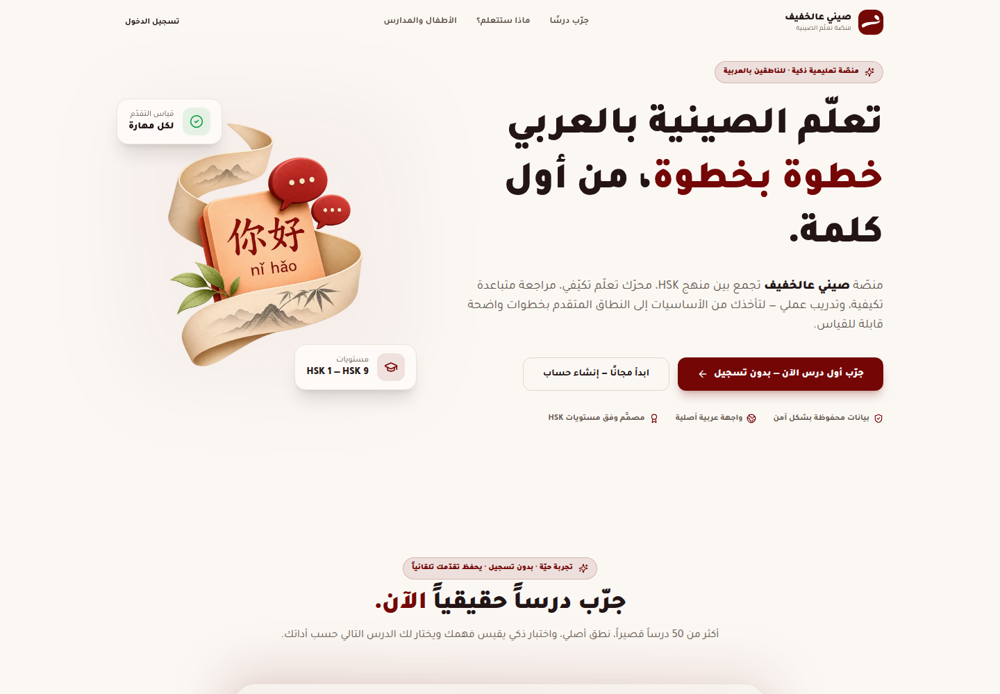
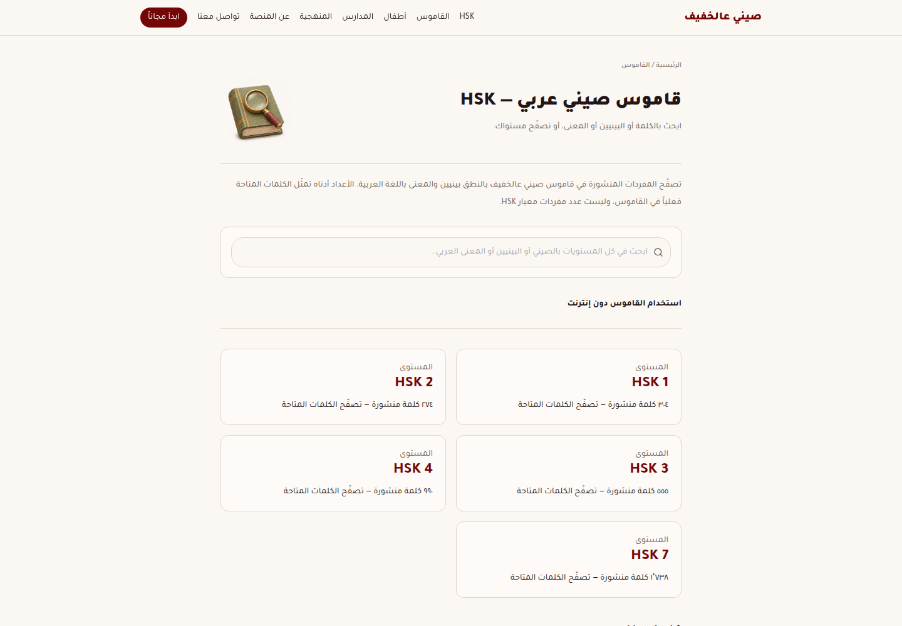
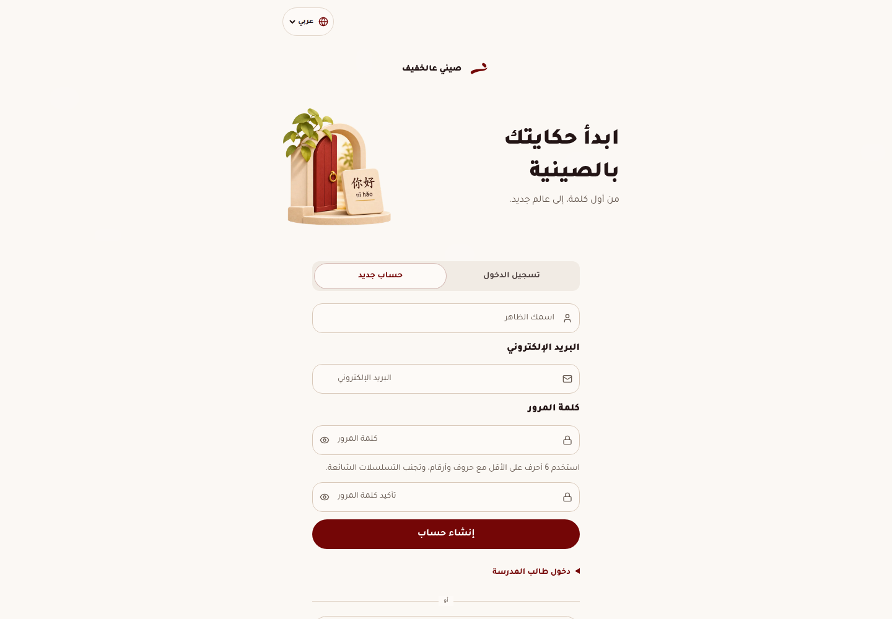

  

<h1 align="center">صيني عالخفيف | Sini Al-Khafif</h1>
<h3 align="center">منصة عربية لتعلّم الصينية عبر مسار HSK 1–9</h3>

<i>دروس قصيرة، مفردات في سياق، ومراجعة خطوة بخطوة.</i>

  
  
  
  

  <a href="https://sinialkhafifapp.com">جرّب المنصة</a> ·
  <a href="https://sinialkhafifapp.com/methodology">منهجية التعلّم</a> ·
  <a href="https://sinialkhafifapp.com/hsk">دليل HSK بالعربية</a> ·
  <a href="https://sinialkhafifapp.com/dictionary">القاموس الصيني–العربي</a>

---

## نبذة عن المشروع

**صيني عالخفيف** منصة تعليمية عربية لتعلّم اللغة الصينية، تنظّم المحتوى وفق مسار HSK وتقدّمه بواجهة وشروح عربية. تجمع التجربة بين دروس قصيرة، ومفردات صينية مع البينيين والمعنى، وأمثلة وتمارين واستماع، إلى جانب أدوات للمراجعة ومتابعة التقدّم.

تخدم المنصة المتعلمين من نقطة البداية إلى الموضوعات المتقدمة، مع تفاوت في عمق المحتوى وتغطيته بين المستويات. كما تضم قاموسًا صينيًا–عربيًا ومسارًا تعليميًا مخصصًا للأطفال.

> **نطاق المستودع:** يحتوي هذا المستودع على وثائق المشروع ومواد الهوية البصرية ولقطات من الموقع وخطة التسويق. لا يحتوي الشيفرة المصدرية للتطبيق أو إعدادات الخادم وقاعدة البيانات؛ لذلك لا يمكن بناء التطبيق أو تدقيق تفاصيل تنفيذه اعتمادًا على هذا المستودع وحده.

## الفئات المستفيدة

تستهدف المنصة المبتدئين والطلاب في المدارس والجامعات، كما تفيد من يحتاج إلى الصينية للدراسة أو العمل أو السفر، والمهتمين باللغة والثقافة الصينية. ويقدم مسار الأطفال تدرجًا مستقلًا يبدأ بالاستماع واللعب والتعرّف إلى الكلمات، ثم ينتقل إلى القراءة والكتابة والتواصل.

## منهجية التعلّم

### تقييم تشخيصي

يساعد التقييم التشخيصي القصير على اقتراح نقطة بداية مناسبة في المسار وفق إجابات المتعلم. وتُعد النتيجة تقديرًا تعليميًا أوليًا، وليست اختبار HSK رسميًا أو شهادة معتمدة. ويتوفر للأطفال مسار مستقل يناسب مرحلتهم.

### التعرّف إلى المفردات في سياق

تُعرض الكلمات الصينية مع **البينيين**، وهو نظام لكتابة النطق الصيني بالحروف اللاتينية، ومعنى عربي وأمثلة. ويساعد وضع المفردة ضمن عبارة أو موقف على ربطها باستخدامها، بدل الاقتصار على قائمة ترجمة منفصلة. ويضم المحتوى تدريبًا على النطق والاستماع بحسب الدرس.

### التطبيق والتحقق

تتدرج الوحدات، بحسب المحتوى المتاح، من التعرّف إلى التطبيق ثم التحقق. وتشمل التمارين أنشطة مثل الاختيار والمطابقة والاستماع والكتابة، مع تدريبات على القراءة والتعرّف إلى الكلمات وتركيب الجمل. وتوضح صفحة المنهجية أن إكمال الدرس وحده لا يثبت الإتقان الدائم.

### المراجعة المتباعدة والتكيّف

تستخدم المنهجية مراجعة متباعدة تعيد الكلمات للتدريب على فترات لاحقة. وتختلف مواعيد المراجعة بحسب حالة العنصر وأداء المتعلم، ولا تتبع جميع الكلمات جدولًا زمنيًا واحدًا. كما يصف الموقع محرّك التعلّم بأنه يحلل الأداء ويعيد ترتيب المحتوى ليتناسب مع احتياجات المتعلم؛ وهذه خصائص معلنة في الموقع، وليست تفاصيل تنفيذية يمكن تدقيقها من هذا المستودع.

### متابعة التقدم

تعرض لوحة المتعلم مؤشرات للمهارات التي تتوفر لها محاولات مسجلة، إلى جانب بيانات النشاط مثل نقاط الخبرة وسلسلة أيام التعلّم. وتشير الصفحة الرئيسية أيضًا إلى تحديات يومية وشهادات إنجاز. وقد لا تتوفر بيانات كافية لبعض مؤشرات المهارات في بداية الاستخدام؛ كما أن بيانات النشاط لا تعادل وحدها إثبات الإتقان.

## مزايا المنصة

### مسار HSK من 1 إلى 9

ينظم المسار المحتوى في ثلاث مراحل عامة: التأسيس في HSK 1–2، والتطوير في HSK 3–6، ثم النطاق المتقدم HSK 7–9. تشمل موضوعات التأسيس التحية والأرقام والعائلة والحياة اليومية، وتتدرج الموضوعات اللاحقة إلى العمل والنقاش والثقافة والنصوص الأطول.

يمثل HSK إطارًا لتنظيم التعلّم، ولا تعني دراسة محتوى المنصة الحصول على شهادة HSK رسمية. ويعرض دليل الموقع المستويات 1–6، إلى جانب النطاق المتقدم الموحد 7–9. كما يوضح الموقع أن عمق المحتوى وتغطيته يختلفان بين المستويات وأن المحتوى المتقدم يتوسع تباعًا.

### القاموس الصيني–العربي

يتيح القاموس البحث بالكلمة الصينية أو بالبينيين أو بالمعنى العربي، وتصفح المفردات المنشورة بحسب المستوى. وتظهر في مداخل الكلمات بيانات مثل البينيين والمعنى العربي ونوع الكلمة والأمثلة بحسب المدخل. كما يتيح الموقع تنزيل الكلمات المنشورة للبحث والتصفح دون اتصال.

أعداد الكلمات الظاهرة في القاموس هي أعداد الكلمات المنشورة والمتاحة فيه، وليست أعداد مفردات معيار HSK الرسمي. وقد تتغير التغطية عند تحديث القاموس.

### مسار تعليمي للأطفال

يبدأ مسار الروضة بالاستماع واللعب والتعرّف إلى الكلمات بالصوت والصورة. ثم يتدرج المستوى الأول إلى القراءة والكتابة من خلال أنشطة مثل المطابقة والحوار. صُمم المسار ليقدم خطوات مناسبة للصغار بدل تطبيق وحدات الكبار عليهم كما هي.

### البدء المجاني والحساب

يذكر الموقع إمكانية البدء مجانًا بمستوى HSK 1 وعدد من دروس HSK 2، مع باقات اشتراك للوصول إلى بقية المسار. وقد تتغير تفاصيل المحتوى والباقات، لذا يُرجى الرجوع إلى الموقع لمعرفة الخيارات الحالية.

تذكر الصفحة الرئيسية أن تجربة الدرس دون تسجيل تحفظ التقدم على الجهاز، بينما تشير مواضع أخرى في الموقع إلى الحفظ السحابي. ولا يحتوي هذا المستودع على الشيفرة المصدرية للتحقق من نطاق المزامنة أو تفاصيل تخزين البيانات؛ لذلك ينبغي مراجعة المعلومات وسياسة الخصوصية المنشورة في الموقع قبل الاعتماد على المزامنة بين الأجهزة.

## الخطة التسويقية

تتضمن [خطة التسويق العربية لمدة 90 يومًا](MARKETING_PLAN_AR.md) التموضع والجمهور والقنوات وجدول المحتوى ومؤشرات القياس وخطوات الجاهزية قبل الإعلانات.

## الشعار ولقطات الواجهات

يضم المستودع أصول الهوية البصرية ولقطات من الصفحات العامة. تمثل اللقطات الموقع وقت تحديث المستودع، وقد تختلف الواجهات الحية عنها لاحقًا.

  

- ملفات SVG: [`assets/brand/app-icon.svg`](assets/brand/app-icon.svg) و[`assets/brand/favicon.svg`](assets/brand/favicon.svg).
- ملفات PNG: [`favicon.png`](assets/brand/favicon.png)، [`icon-192.png`](assets/brand/icon-192.png)، و[`apple-touch-icon.png`](assets/brand/apple-touch-icon.png).

<table>
  <tr>
    <td width="50%" align="center"> <b>الصفحة الرئيسية</b></td>
    <td width="50%" align="center"> <b>دليل HSK</b></td>
  </tr>
  <tr>
    <td width="50%" align="center"> <b>القاموس الصيني–العربي</b></td>
    <td width="50%" align="center"> <b>المنهجية</b></td>
  </tr>
  <tr>
    <td width="50%" align="center"> <b>تسجيل الدخول</b></td>
    <td width="50%" align="center"> <b>إنشاء حساب</b></td>
  </tr>
</table>

وتشمل اللقطات الكاملة صفحات [HSK 1](screenshots/current/hsk-1.png)، و[عن المنصة](screenshots/current/about.png)، و[التواصل](screenshots/current/contact.png). أما الملفات الأقدم في مجلدات `screenshots/` و`screenshots/live/` فهي لقطات أرشيفية من إصدارات سابقة.

## صفحات المنصة

- [الموقع والتجربة الحية](https://sinialkhafifapp.com)
- [منهجية التعلّم](https://sinialkhafifapp.com/methodology)
- [دليل HSK بالعربية](https://sinialkhafifapp.com/hsk)
- [القاموس الصيني–العربي](https://sinialkhafifapp.com/dictionary)
- [معلومات عن المنصة](https://sinialkhafifapp.com/about)
- [تسجيل الدخول وإنشاء حساب](https://sinialkhafifapp.com/auth)
- [التواصل](https://sinialkhafifapp.com/contact)

## عن المستودع والمساهمة

هذا المستودع مخصص للتوثيق ومواد الهوية واللقطات وخطة التسويق، ولا يحتوي ملفات التطبيق أو إعدادات تشغيله. يمكن اقتراح تحسينات للتوثيق والصور عبر نقاشات المستودع. أما المساهمة في شيفرة التطبيق فتتطلب الوصول إلى مستودع الشيفرة المصدرية المناسب.

## المطوّر

تم تطوير منصة **صيني عالخفيف** من قبل **ماجد السكني**.

---

<i>تعلّم الصينية بالعربي، خطوة بخطوة.</i>

