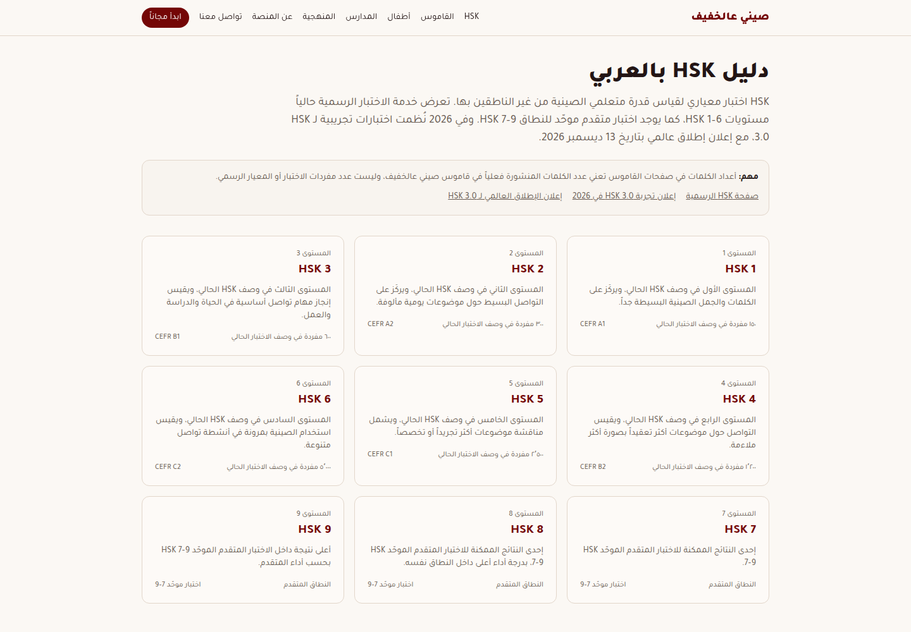

  

<h1 align="center">صيني عالخفيف | Sini Al-Khafif</h1>
<h3 align="center">تعلّم الصينية للناطقين بالعربية عبر مسار HSK 1–9</h3>

<i>دروس قصيرة، مفردات في سياق، ومراجعة خطوة بخطوة.</i>

  
  
  
  

  <a href="https://sinialkhafifapp.com">جرّب المنصة</a> ·
  <a href="https://sinialkhafifapp.com/methodology">اقرأ منهجية التعلّم</a> ·
  <a href="https://sinialkhafifapp.com/hsk">دليل HSK بالعربية</a> ·
  <a href="https://sinialkhafifapp.com/dictionary">القاموس الصيني–العربي</a>

---

## قصتي مع صيني عالخفيف

أنا ماجد السكني، مطوّر ومشرف مشروع **صيني عالخفيف**. أنشأت هذا المشروع لمساعدة الناطقين بالعربية على بدء تعلّم الصينية ومواصلة التقدّم فيها من خلال تجربة عربية واضحة، بدل أن يضطر المتعلّم إلى الاعتماد على شروح بلغة أخرى أو التنقل بين أدوات متفرقة.

أبني التجربة حول هدف عملي: أن يعرف المتعلّم ماذا يتعلّم، ولماذا يتعلّمه، وكيف يراجع ما سبق. لذلك تجمع المنصة بين مسار HSK، وشرح عربي، ومفردات صينية مع البينيين والمعنى، وتمارين، واستماع، ومراجعة ومتابعة للتقدّم. أعمل على تطوير المحتوى والتجربة تدريجيًا، وقد تختلف درجة اكتمال المحتوى بين مستوى وآخر.

> **ملاحظة عن هذا المستودع:** هذا المستودع العام يوثّق المشروع ويضم مواد الهوية البصرية ولقطات من الموقع وخطة التسويق. لا يحتوي الشيفرة المصدرية للتطبيق أو إعدادات الخادم وقاعدة البيانات، لذلك لا يمكن بناء التطبيق أو تدقيق تفاصيل تنفيذه اعتمادًا على هذا المستودع وحده.

## لمن أعمل على هذه المنصة؟

أوجّه صيني عالخفيف إلى المبتدئ العربي الذي يريد التعرّف إلى الصينية من البداية، وإلى الطالب الذي يدرسها في المدرسة أو الجامعة. كما يمكن أن يستفيد منها من يحتاج الصينية للدراسة أو العمل أو السفر، ومن يهتم باللغة والثقافة الصينية. صممت كذلك مسارًا خاصًا بالأطفال يبدأ بالتعرّف السمعي واللعب، ثم يتدرج نحو القراءة والكتابة والتواصل.

## كيف صممت تجربة التعلّم؟

### 1. نقطة بداية مناسبة

تبدأ الرحلة بتقييم تشخيصي قصير يساعد على اقتراح نقطة بداية في المسار. أتعامل مع نتيجته كتقدير تعليمي أولي لمستوى المتعلّم، وليس كشهادة أو نتيجة رسمية لاختبار HSK. وللأطفال مسار منفصل يناسب مرحلتهم.

### 2. تعرّف على الكلمات داخل سياق

أقدّم المفردات الصينية مع البينيين، وهو نظام كتابة يساعد على قراءة النطق الصيني بالحروف اللاتينية، ومعنى عربي وأمثلة. الهدف أن يرى المتعلّم الكلمة ضمن عبارة أو موقف، لا أن يتعامل معها كقائمة ترجمة منفصلة عن الاستخدام.

### 3. طبّق ما تعلّمته

تتدرج الوحدة، بحسب محتواها، من التعرّف إلى التطبيق ثم التحقق. وتشمل التمارين المعروضة أنشطة مثل الاختيار والمطابقة والاستماع والكتابة. ويتيح الموقع تدريبًا يجمع أكثر من مهارة في مسار الدرس، مثل الاستماع والقراءة والتعرّف إلى الكلمات وتركيب الجمل.

### 4. راجع على فترات

أستخدم في تصميم المنهجية مفهوم **المراجعة المتباعدة**: العودة إلى المفردات بعد فواصل زمنية بدل الاكتفاء بمراجعتها مرة واحدة. وتوضح صفحة المنهجية أن توقيت المراجعة يتغير وفق حالة العنصر وأداء المتعلّم، لذلك لا أصفها بجدول ثابت واحد لجميع الكلمات. إكمال درس منفرد لا يعني وحده أن المعلومة ترسخت نهائيًا.

### 5. تابع مؤشرات تقدّمك

يعرض الموقع مؤشرات للتعلّم والمهارات التي تتوفر لها محاولات مسجلة، إلى جانب بيانات النشاط مثل النقاط وسلسلة أيام التعلّم. أفصل بين النشاط اليومي وبين دليل الإتقان: فقد تحتاج بعض المؤشرات إلى بيانات ومحاولات أكثر قبل أن تعطي صورة كافية عن التقدّم.

## ما الذي تقدمه المنصة؟

### مسار HSK من 1 إلى 9

أنظم المحتوى وفق مستويات HSK، من مرحلة التأسيس في HSK 1–2 إلى مرحلة التطوير في HSK 3–6، ثم النطاق المتقدم HSK 7–9. وتشمل موضوعات التأسيس التحية والأرقام والعائلة والحياة اليومية، بينما تتسع الموضوعات في المراحل اللاحقة لتشمل العمل والنقاش والثقافة والنصوص الأطول.

المستويات المتقدمة 7–9 جزء من نطاق HSK المتقدم، وليست في دليل الموقع ثلاثة اختبارات منفصلة بالطريقة نفسها المستخدمة للمستويات 1–6. كما أن عمق المحتوى وتغطيته يختلفان بين المستويات، وما زال المحتوى المتقدم يتوسع. أستخدم أرقام HSK بوصفها إطارًا لتنظيم التعلّم، ولا أقدّم إكمال مسار المنصة على أنه شهادة HSK رسمية.

### القاموس الصيني–العربي

أضفت قاموسًا يمكن البحث فيه بالكلمة الصينية أو بالبينيين أو بالمعنى العربي، كما يمكن تصفح المفردات المنشورة بحسب المستوى. وتعرض صفحات القاموس البينيين والمعنى العربي ونوع الكلمة والأمثلة بحسب بيانات المدخل. ويتيح الموقع تنزيل الكلمات المنشورة لتصفحها والبحث فيها دون اتصال.

أعداد الكلمات الظاهرة في القاموس تعني عدد الكلمات المتاحة فعليًا في القاموس، ولا تعني عدد مفردات معيار HSK الرسمي. وقد تتغير التغطية مع إضافة مواد جديدة.

### مسار للصغار

أنشأت مسارًا تعليميًا للأطفال ضمن تجربة المنصة نفسها. يبدأ مسار الروضة بالاستماع واللعب والتعرّف إلى الكلمات بالصوت والصورة. ثم ينتقل المستوى الأول تدريجيًا إلى القراءة والكتابة من خلال أنشطة مثل المطابقة والحوار. أبقيت التدرّج مناسبًا للعمر بدل نسخ وحدات الكبار كما هي.

### تجربة البدء والحساب

يمكن للزائر تجربة جزء من المحتوى قبل الالتزام، ويذكر الموقع أن البدء المجاني يشمل HSK 1 وعددًا من دروس HSK 2، مع باقات للوصول إلى بقية المسار. تفاصيل المحتوى والأسعار المعروضة قد تتغير، لذلك أرجع المستخدم إلى الموقع لمعرفة المتاح حاليًا.

تذكر الصفحة الرئيسية أن تجربة الدرس دون تسجيل تحفظ التقدّم على الجهاز، بينما تشير مواضع أخرى في الموقع إلى الحفظ السحابي. ولأن الشيفرة المصدرية ليست ضمن هذا المستودع، لا أستطيع توثيق نطاق المزامنة أو تفاصيل تخزين البيانات هنا؛ ينبغي الرجوع إلى ما تعرضه المنصة وسياسة الخصوصية الحالية قبل الاعتماد على المزامنة بين الأجهزة.

## لمن قد تكون مفيدة؟

أرى أن المنصة قد تناسب من يريد تجربة تعلّم عربية منظمة للصينية، ومن يحتاج إلى مراجعة مفردات مرتبطة بمستواه، وكذلك المسافرين والطلاب والمهتمين بالتواصل مع أشخاص أو جهات ناطقة بالصينية. وهي مورد تعلّم وممارسة، وليست بديلًا عن اختبار HSK الرسمي أو شهادة معتمدة.

## الخطة التسويقية

أعددت [خطة تسويق عربية لمدة 90 يومًا](MARKETING_PLAN_AR.md) توضّح التموضع والجمهور والقنوات وجدول المحتوى ومؤشرات القياس وخطوات الجاهزية قبل الإعلانات.

## الشعار ولقطات الواجهات

أضع هنا أصول الهوية البصرية ولقطات من الصفحات العامة للموقع. اللقطات تمثل الموقع وقت تحديث المستودع، وقد تتغير الواجهات الحية بعد التقاطها.

  

- ملفات SVG: [`assets/brand/app-icon.svg`](assets/brand/app-icon.svg) و[`assets/brand/favicon.svg`](assets/brand/favicon.svg).
- ملفات PNG: [`favicon.png`](assets/brand/favicon.png)، [`icon-192.png`](assets/brand/icon-192.png)، و[`apple-touch-icon.png`](assets/brand/apple-touch-icon.png).

<table>
  <tr>
    <td width="50%" align="center"> <b>الصفحة الرئيسية</b></td>
    <td width="50%" align="center"> <b>دليل HSK</b></td>
  </tr>
  <tr>
    <td width="50%" align="center"> <b>القاموس الصيني–العربي</b></td>
    <td width="50%" align="center"> <b>المنهجية</b></td>
  </tr>
  <tr>
    <td width="50%" align="center"> <b>تسجيل الدخول</b></td>
    <td width="50%" align="center"> <b>إنشاء حساب</b></td>
  </tr>
</table>

وتشمل اللقطات الكاملة صفحات [HSK 1](screenshots/current/hsk-1.png)، و[عن المنصة](screenshots/current/about.png)، و[التواصل](screenshots/current/contact.png). أما الملفات الأقدم في مجلدات `screenshots/` و`screenshots/live/` فهي لقطات أرشيفية من إصدارات سابقة.

## الصفحات الرئيسية

- [الموقع والتجربة الحية](https://sinialkhafifapp.com)
- [منهجية التعلّم](https://sinialkhafifapp.com/methodology)
- [دليل HSK بالعربية](https://sinialkhafifapp.com/hsk)
- [القاموس الصيني–العربي](https://sinialkhafifapp.com/dictionary)
- [معلومات عن المنصة](https://sinialkhafifapp.com/about)
- [تسجيل الدخول وإنشاء حساب](https://sinialkhafifapp.com/auth)
- [التواصل](https://sinialkhafifapp.com/contact)

## عن هذا المستودع والمساهمة

أستخدم هذا المستودع لنشر تعريف المشروع ومواده التوثيقية والمرئية. لا يحتوي ملفات التطبيق أو إعدادات تشغيله، لذلك لا يمكن بناء المنتج منه في الوقت الحالي. إذا كان لديك اقتراح لتحسين التوثيق أو الصور، يمكنك فتح نقاش أو تواصل معي. أما المساهمة في شيفرة التطبيق فتحتاج إلى الوصول إلى مستودع الشيفرة المصدرية المناسب.

## المطوّر والمشرف

أنا **ماجد السكني | Majid Al-Sakani**، مطوّر ومشرف مشروع صيني عالخفيف.

[ملفي على GitHub](https://github.com/majid-alsakani) · [موقع صيني عالخفيف](https://sinialkhafifapp.com) · [مستودع المشروع](https://github.com/majid-alsakani/sini-alkhafif-app)

---

<i>تعلّم الصينية بالعربي، خطوة بخطوة.</i>

